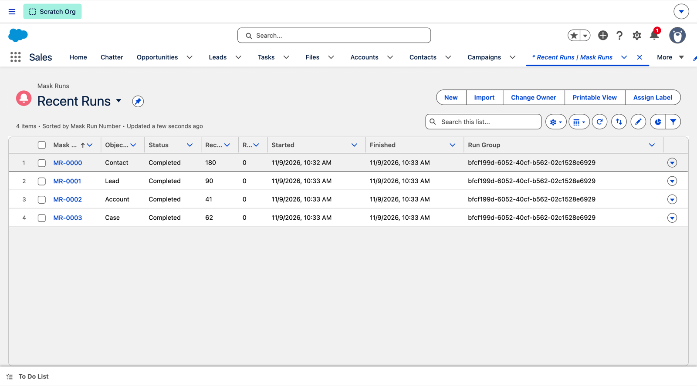
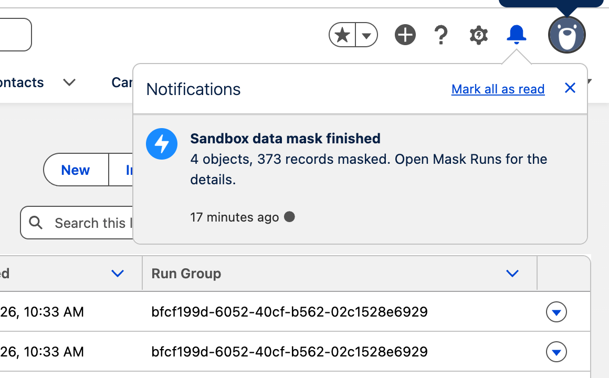
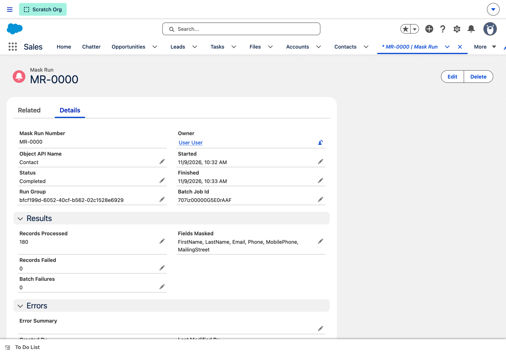
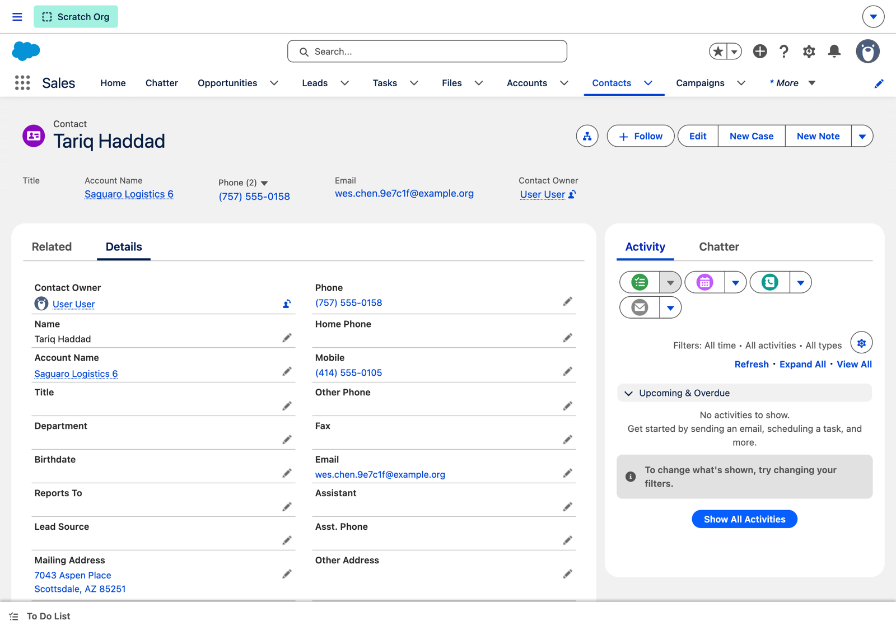
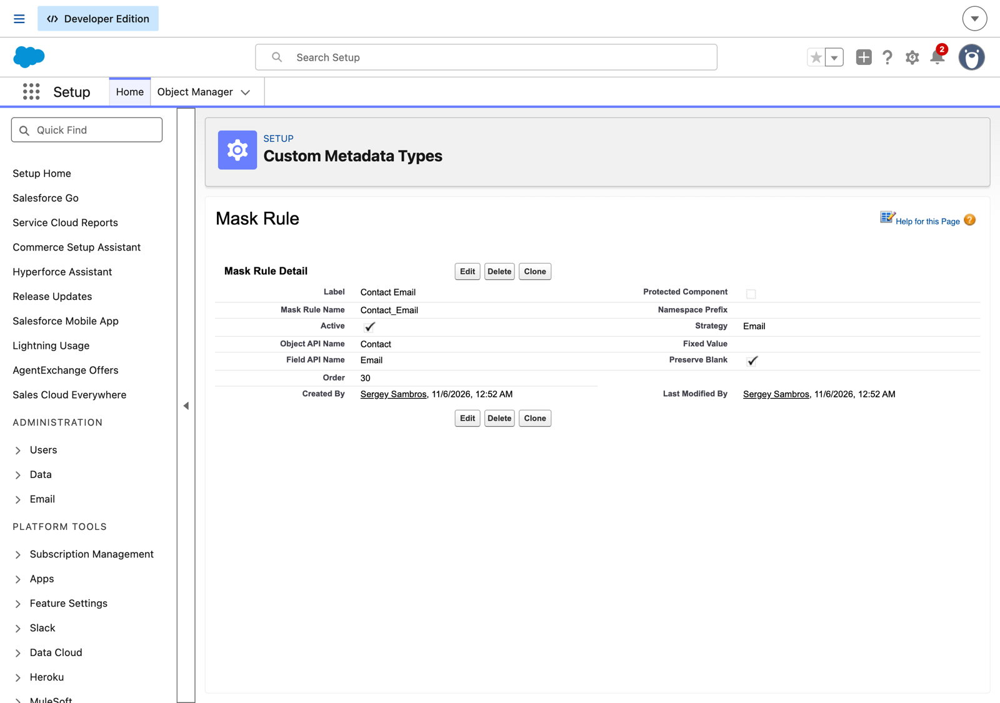

# sandbox-data-mask

[](https://github.com/s3rj/sandbox-data-mask/actions/workflows/ci.yml)


[](LICENSE)

Deterministic PII masking for Salesforce sandboxes, driven by custom metadata, with a post-refresh hook so a sandbox is clean before the first tester logs in, a coverage audit so the rules keep up with the schema, and an audit trail so compliance can see what was done and when.

**At a glance**

- **The problem:** a refreshed sandbox is a copy of production, customer data included, and the one-off script that was supposed to scrub it stopped matching the schema two releases ago.
- **What this is:** an Apex batch driven by `Mask_Rule__mdt` that replaces personal data with deterministic fakes, refuses to run anywhere but a sandbox, audits its own coverage against the schema, and writes a run record per object.
- **Proof:** 45 tests, 97% coverage, validated in a Developer Edition org on API 68.0; the coverage audit ran live against that org's schema (its report is below), and a full run executed in a scratch org over 370 seeded records (the screenshots below).
- **Try it:** deploy, assign `Sandbox_Data_Mask_Admin`, run `scripts/apex/audit-coverage.apex` anywhere and `scripts/apex/run-mask.apex` in a sandbox.
- **Where to look first:** `MaskStrategies` (the nine strategies, deterministic through `Deterministic`), `MaskPlan` (validation against the describe before anything is queued), `SandboxDataMaskBatch` (bulk-safe partial-success update and the chain), `MaskCoverageAudit` (type, name, and compliance-categorization signals), and `SandboxDataMaskBatchTest` for the end-to-end run.

## What admins see

Taken in a scratch org, which counts as a sandbox, after one `SandboxDataMaskRunner.run()` over 370 seeded records with obvious personal data.

**The run list.** One Mask Run per object, in rule order, with record counts and the run group that ties them together.



**The bell.** When the last object finishes, the user who started the run, or who requested the refresh, gets a notification with the totals.



**One run.** Which fields were masked, how many records, how many failed, and the batch job id for Setup > Apex Jobs.



**A masked contact.** Name, phones, email, and street are fakes; city, state, and account are untouched because no rule targets them. The same input always produces the same fake, so two contacts who shared a street before the run still share one after it.



## Why an org needs it

A refreshed Full or Partial sandbox is a copy of production: customer names, emails, phone numbers, addresses, and whatever else lives in custom fields, readable by every developer, tester, contractor, and offshore partner with a login. Salesforce only neuters User emails. Privacy frameworks (GDPR, CCPA, HIPAA) treat that copy as personal data, and auditors ask how it is protected. Most teams cover the gap with an anonymous Apex script someone wrote once, that nobody re-runs after a refresh, and that silently stops covering the field that was added last quarter.

## What your org gets

- **A sandbox that is clean before anyone logs in.** Pick `MaskPostCopy` as the Apex class when creating or refreshing a sandbox and the mask runs the moment the copy finishes. No ticket, no reminder, no window where the data is exposed.
- **Rules admins own, in Setup.** Each `Mask_Rule__mdt` record names an object, a field, and a strategy. Adding a field to the mask is a metadata record, not a code change, and the rules deploy and version with the rest of the org.
- **Test data that still works.** Every fake is derived from the original value and a per-org salt, so the same customer gets the same fake name, email, and phone on the Contact, the Lead, and the Case, in every run and after every refresh. Duplicate rules, reports, and testers' scripts keep behaving; nothing about the original can be recovered without the salt.
- **A coverage audit after every schema change.** `MaskCoverageAudit` lists fields that look like personal data but have no rule: by type (Email, Phone, Encrypted Text), by name (`Birthdate`, `SSN__c`, `Home_Address__c`), and by the Compliance Categorization and Data Sensitivity Level your admins already record on fields in Setup. Run it in production before the refresh; it reads the schema, not the data.
- **A preview before the batch.** `MaskPreview` shows before-and-after values for a handful of records, so a wrong strategy is caught on five records instead of five hundred thousand.
- **A heads-up when it is done.** The user who started the run gets a Lightning bell notification (desktop and mobile) with the totals: objects, records masked, failures. Email would not arrive from most sandboxes; this does.
- **Evidence for the auditors.** One `Mask_Run__c` record per object per run, grouped by run: fields masked, records processed and failed, batch job id, timings, and the first 25 record-level errors. The **Recent Runs** and **Runs With Errors** list views on the Mask Runs tab are the review screen.
- **It cannot touch production.** `Organization.IsSandbox` is checked before anything is queued and again inside the batch; the preview refuses too.
- **It fails fast on bad configuration.** Object and field names, updateability, nullability, and strategy/field-type compatibility are validated against the describe before the first batch is queued, so a typo in a rule is an error in the caller's face, not a half-masked sandbox.

## Strategies

| Strategy | Produces | Example |
|---|---|---|
| `FirstName` | A first name from a word list, chosen by the original value | `Alice` → `Priya` |
| `LastName` | A last name from a word list | `Smith` → `Okafor` |
| `Email` | `first.last.tag@example.{com,net,org}` (RFC 2606 reserved domains, so nothing can be delivered) | `alice@customer.test` → `ada.okafor.3f9a2c@example.org` |
| `Phone` | `(NXX) 555-01XX`, the block reserved for fiction | `602-555-1234` → `(480) 555-0147` |
| `Street` | House number plus a street from a word list | `1 Real Rd` → `4821 Juniper Boulevard` |
| `Scramble` | Same length, letters stay letters (case kept), digits stay digits, punctuation stays put | `ACME-00123 Co.` → `QZTR-84910 Lw.` |
| `Hash` | `h_` plus 16 hex characters: an opaque token that still joins | `secret` → `h_9c2f...` |
| `Fixed` | The rule's `Fixed Value`, or null when blank | `CEO` → `Redacted` |
| `Null` | Clears the field. The only strategy that works on non-text fields | `1985-04-12` → null |

Text strategies work on Text, Text Area, Long Text Area, Email, Phone, and URL fields and are truncated to the field's length. Records where the field is already blank are left blank unless the rule unchecks **Preserve Blank**.

## Install

```bash
sf project deploy start --target-org <sandbox>
sf org assign permset --name Sandbox_Data_Mask_Admin --target-org <sandbox>
```

The shipped rules cover the usual suspects: Contact and Lead names, emails, phones, and streets; Account phones and addresses; Case supplied name, email, and phone; Lead company (scrambled). Edit, deactivate, or add rules under **Setup > Custom Metadata Types > Mask Rule**; the shipped layout shows every field:



## Run

Any of these:

```bash
sf apex run --target-org <sandbox> --file scripts/apex/run-mask.apex
```

```apex
Id firstRun = SandboxDataMaskRunner.run();
```

- **Flow:** add the Apex action **Run sandbox data mask** (optional input: batch size).
- **Automatically after every refresh:** in **Setup > Sandboxes**, when creating or refreshing a sandbox, set **Apex Class** to `MaskPostCopy`. The mask runs as soon as the copy finishes, as the user who requested the refresh, who also gets the notification.

Progress is on the **Mask Runs** tab or with `scripts/soql/mask-runs.soql`. When the last object finishes, the bell rings: "Sandbox data mask finished: 4 objects, 12,340 records masked."

## Keep the rules honest

After a release that added fields, before the next refresh, in any org:

```bash
sf apex run --target-org <org> --file scripts/apex/audit-coverage.apex
```

```
23 field(s) look like personal data and have no active mask rule:
  Account.Fax                                 Phone           Phone field; name suggests personal data ("fax")
  Contact.Birthdate                           Date            name suggests personal data ("birthdate"); only the Null strategy fits a Date field
  Contact.HomePhone                           Phone           Phone field; name suggests personal data ("phone")
  Contact.OtherStreet                         Text Area       name suggests personal data ("street")
  ...
Add a Mask Rule for each one that should be masked (Setup > Custom Metadata Types > Mask Rule).
```

That is the shipped rule set against a fresh Developer Edition org: the audit finds what the rules miss. By default it covers every object that has a rule, Account, Contact, Lead, Case, and every custom object; pass your own set with `MaskCoverageAudit.audit(new Set<String>{ 'Contact', 'Patient__c' })` on a big org. The Flow action **Audit mask coverage** returns the same report as text, so a scheduled flow can email it to the data owner.

Then, in the sandbox, check a rule change on a few records before the batch:

```bash
sf apex run --target-org <sandbox> --file scripts/apex/preview-mask.apex
```

```
Preview of the active rules on Contact: 5 record(s), nothing written.
003xx000004TmiQAAS
  FirstName               Alice  ->  Priya
  Email                   alice@customer.test  ->  ada.okafor.3f9a2c@example.org
  ...
```

## Keeping fakes stable across refreshes

The salt lives in the **Mask Settings** hierarchy custom setting. The first run (or preview) in a sandbox generates one if it is blank, which keeps fakes stable across runs in that sandbox. To keep them stable across refreshes too, set `Salt` once in production: custom-setting data is copied with every refresh, and the tool never writes to production (it cannot run there). Changing the salt changes every fake on the next run.

## Scoping and exclusions

`Mask_Object__mdt` takes a `WHERE` clause without the keyword, for example:

| Object | Where Clause | Effect |
|---|---|---|
| Lead | `IsConverted = false` | Converted leads keep their data (their Contact gets masked instead) |
| Contact | `Account.Is_Internal__c = false` | Leave the team's own test accounts readable |
| Case | `CreatedDate = LAST_N_DAYS:365` | Only recent cases |

An inactive `Mask_Object__mdt` row switches an object off entirely, even if it has active rules (the coverage audit then reports those fields as unmasked, which they are). Where clauses are admin-managed metadata, not user input; validation checks object and field names against the describe before any query is built.

## What it does not do

- **Automation still fires.** Record-triggered flows, triggers, and validation rules run on the masking updates. If your org has a bypass pattern (a custom permission or a hierarchy custom setting), grant it to the running user before masking; otherwise expect some records to fail validation and show up in the run's error summary.
- **It does not mask Users, Usernames, or Person Accounts' person fields** out of the box. Users can be added as rules if the running user can edit them; Salesforce already invalidates User emails on refresh.
- **It does not touch field history, Chatter, email message bodies, attachments, or files.** Those need their own cleanup.
- **It is not encryption.** Deterministic fakes let a reader with the salt and a candidate value check whether that value was present. Keep the salt in production where only admins see it.
- **The audit is a checklist, not a verdict.** It flags fields by type, name, and classification; a human decides which ones matter (a bounced-email reason is on the list; a company name is not).
- **Big objects and external objects** are out of scope.

## Development

```bash
scripts/validate.sh <org alias>     # deploy and run all local tests with coverage
pmd check -d force-app -R pmd/ruleset.xml -f text   # static analysis, same ruleset as CI
```

Validated in a Developer Edition org on API 68.0: 45 tests, 88–100% coverage per class (97% org-wide), and the coverage audit run live against the org's schema (the 23-field report above).

CI runs PMD on every push and, when the `SF_AUTH_URL` secret is present (output of `sf org display --verbose`), deploys to that org and runs the tests.

Tests inject rules through `MaskRuleRepository.ruleOverride` because custom metadata records cannot be inserted in a test context, and set `OrgGuard.isSandboxOverride` because the test org may not be a sandbox. Batch chaining to the next object is skipped in tests, where only one batch execution is allowed.

## Design notes

- **One batch per object, chained from `finish()`**, rather than one batch over a union of objects: each object gets its own query locator, its own batch size, and its own audit record, and a failure in one object does not stop the others. The records of one run share a `Run Group`, so the last batch can total them for the notification and an auditor can filter one refresh's run.
- **Custom metadata, not custom settings, for rules**: rules are configuration that should travel with deployments and show up in version control. The salt is the one value that must differ between orgs, so it is a custom setting.
- **Deterministic over random**: random fakes are simpler, but they break the relationships testers rely on (the same customer on two objects, the same email in a test script) and make duplicate rules fire unpredictably.
- **Validation before queuing**: Apex batch failures are quiet; a `ConfigException` thrown synchronously from `run()` is not.
- **The audit reads three signals** because each misses something: types catch `Fax` whatever it is called, names catch `SSN__c` whatever its type, and the compliance categorization catches the field only the data owner knows is sensitive.
- **A bell notification, not an email**: sandboxes default to "System email only" after a refresh, so an Apex email would be dropped. Custom notifications are delivered everywhere and link straight to the run record.

## Part of a set

Three Salesforce patterns generalized from production work and rebuilt from scratch with tests and CI, plus a CLI for the schema side:

- [sandbox-data-mask](https://github.com/s3rj/sandbox-data-mask): this project, the data in your sandboxes
- [integration-log-retry](https://github.com/s3rj/integration-log-retry): outbound callouts that log, retry, and recover
- [hmac-webhook-receiver](https://github.com/s3rj/hmac-webhook-receiver): inbound webhooks that are verified, deduplicated, and reprocessable
- [flow-hardcoded-id-scanner](https://github.com/s3rj/flow-hardcoded-id-scanner): a CI gate that finds hard-coded record Ids in Flow and other metadata

More at [github.com/s3rj](https://github.com/s3rj).

## License

MIT
